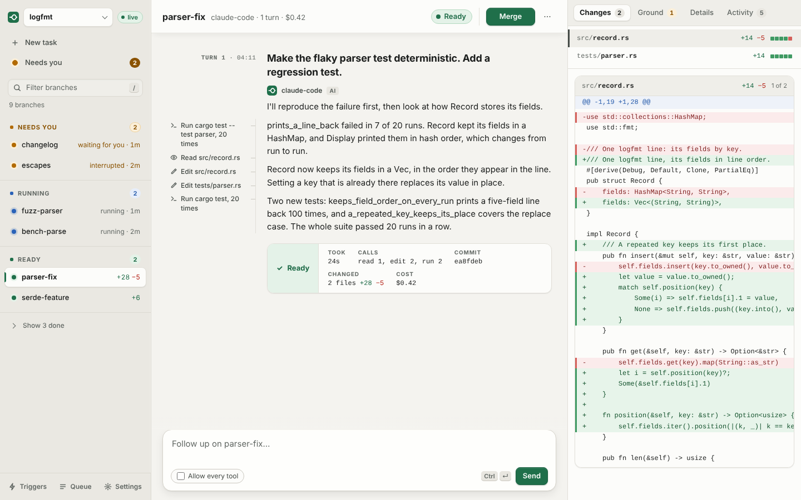
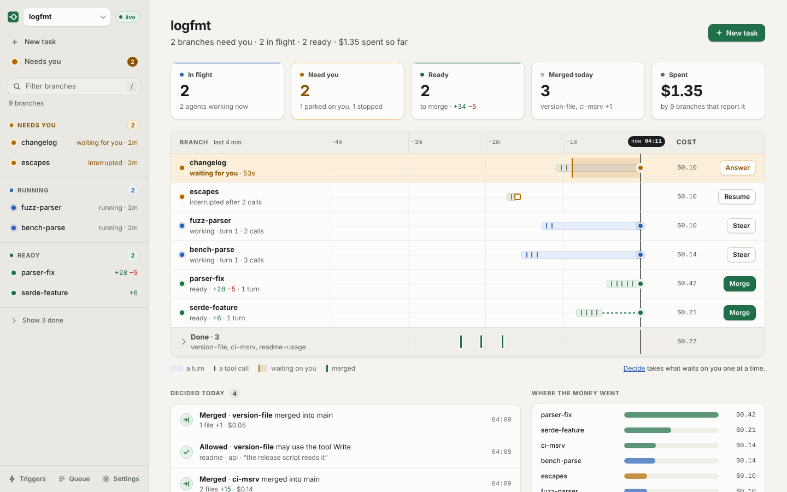
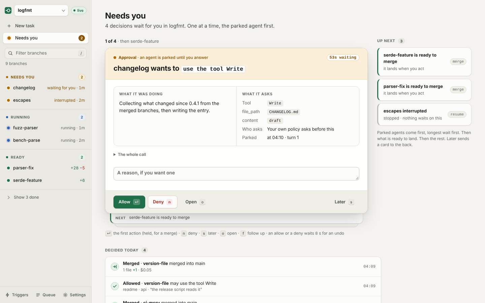
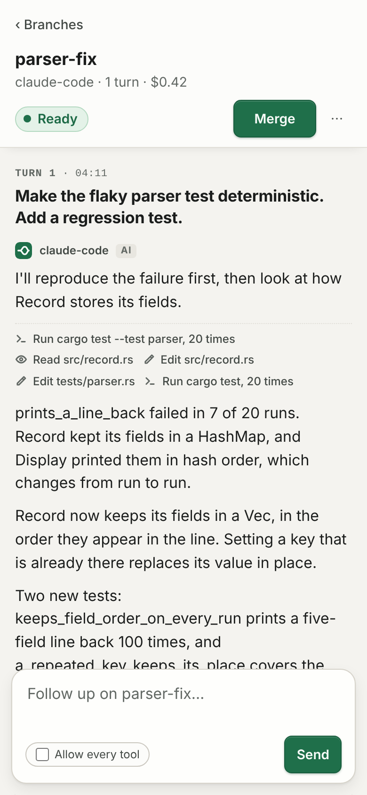
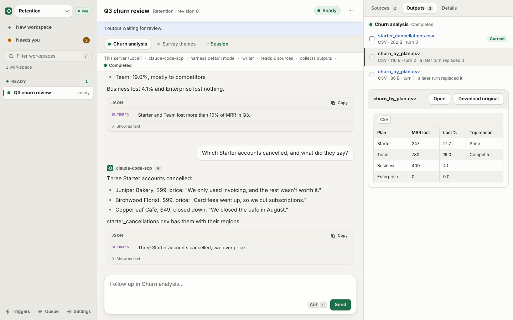

# Branchyard

Run several coding agents at once. Each one works on its own branch. You merge what passes.

<picture>
  <source media="(prefers-color-scheme: dark)" srcset="assets/screenshots/console-branches-dark.png">
  
</picture>

<sub>A scripted agent made this demo data. No model ran. [Regenerate the screenshots](assets/screenshots/README.md).</sub>

## Why

One agent in one checkout works. Two agents in one checkout overwrite each other's files. You lose track of which change came from which request. When a task ends, you still have to find its changes, run the tests and decide.

Branchyard fixes that:

- **Each task gets its own branch and worktree.** Agents never touch each other's files, or yours.
- **Your agent runs as it is.** Antigravity, Claude Code, Codex and others keep their own login and tools.
- **You see everything in one place.** The terminal or the browser shows what each agent said, changed and spent.
- **Nothing lands until it passes.** `by merge` runs your check on the merged result first.

## Install

Run this from your repository:

```sh
curl -fsSL https://github.com/vamsiramakrishnan/branchyard/releases/latest/download/install.sh | sh -s -- --setup
```

Setup finds the agents you have and connects them. It lists any login or trust step left for you. `by up --plan` checks readiness and changes nothing. [Install options](docs/distribution.md#install-by) covers pinned versions and headless machines.

## Run a task

```sh
by run "Make the flaky parser test deterministic. Add a regression test." \
  --name parser-fix --harness antigravity \
  --check "cargo test" --yes --allow-unapproved-tools
by diff parser-fix
by merge parser-fix
```

The agent works on `by/parser-fix`. `by diff` shows its changes. `by merge` runs `cargo test` on the merged result and merges only if it passes. Use your own test command.

`--yes` approves the requests that reach Branchyard. `--allow-unapproved-tools` lets Antigravity apply its own tool rules. A local agent runs as you and can read your files. [Execution modes](docs/modes.md) lists the stronger isolation options.

`by watch` follows running tasks in the terminal. [Cooperative teams](docs/cooperative-teams.md) splits building and reviewing across agents.

## Follow work in the browser

`by serve --app` serves the console. `by serve token new --link` prints a sign-in link.

Home is a board. Every open branch sits on one clock. Each turn is a bar and each tool call a tick. Amber means it waits on you.

<picture>
  <source media="(prefers-color-scheme: dark)" srcset="assets/screenshots/console-board-dark.png">
  
</picture>

Needs you is a deck. You take one decision at a time, with the question, the evidence and the answers.

<picture>
  <source media="(prefers-color-scheme: dark)" srcset="assets/screenshots/console-decide-dark.png">
  
</picture>

The console works on a phone. The [console guide](docs/companion.md) covers pairing, permissions and notifications.

<p align="center"></p>

## Work with documents and data

```sh
by serve --app --knowledge
```

Run it from any folder. It does not need to be a Git repository. Create a project and upload your sources. Start one or more sessions. Each works in its own copy. Preview what they produce and keep what you want. The [console guide](docs/companion.md#projects-and-workspaces) covers credentials, permissions and previews.

<picture>
  <source media="(prefers-color-scheme: dark)" srcset="assets/screenshots/console-workspace-dark.png">
  
</picture>

The [skills](plugins/branchyard/skills/INDEX.md) teach agents to read sources, clean tables, calculate and write editable documents. In the [parallel deck example](examples/rigs/parallel-deck.toml), several workers draft sections and one assembles the deck.

The [document tools](docs/artifact-toolkit.md#installed-skills-and-runtime) need their packages first. Office previews need LibreOffice and Poppler. Google Workspace needs a connected account. See [knowledge work](docs/knowledge-skills.md) and [collecting output files](docs/artifact-capture.md).

## Run on another machine

With `by` and your agent installed on an SSH worker:

```sh
by --remote ssh://you@worker.example/srv/project ls
```

`by serve` runs the same tasks for a team or on remote machines. See the [SSH guide](docs/remote-ssh.md), [GCE setup](docs/compute-gce.md) and [GKE setup](docs/substrate-gke.md).

## Status

Branchyard is early. The [status page](docs/status.md) lists what has run, on which versions, and what has not.

## Documentation

[Getting started](docs/getting-started.md) · [All guides](docs/README.md) · [SDKs](docs/sdk.md) · [Contributing](CONTRIBUTING.md)

The same pages are a [searchable site](https://vamsiramakrishnan.github.io/branchyard/), built from `docs/` on every push to `main`.

## License

Branchyard's own code is [Apache-2.0](LICENSE). Bundled dependencies keep their own licenses. See [third-party notices](THIRD_PARTY.md).
