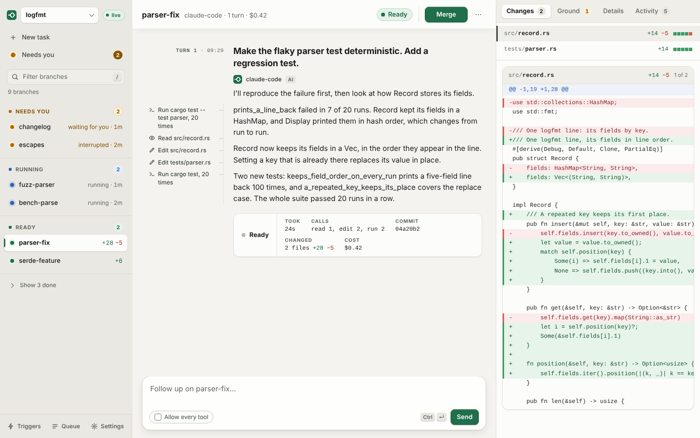

# Web companion

`by serve --app` serves a browser console at `/app/` for monitoring, steering, and merging branches from a desktop browser or a mobile phone. It organizes branches by what they need from you (**Needs you** for approvals, questions, and escalations; **Board** for active and completed runs), shows each branch's conversation, diffs, and raw activity, and supports the same remote actions as `by watch`. To connect a phone, you can generate a one-time pairing link (with a terminal QR code) that signs the browser in with an expiring scoped token and supports Web Push notifications when a branch needs your attention. On a server configured with knowledge projects, the same console also hosts [projects and workspaces](#projects-and-workspaces), where you can upload source documents, run multiple sessions side by side, preview generated files, and accept deliverables.

> **Office document viewer, 1 November 2026.** Evidence: hermetic component browser tests and live converters on generated fixtures, with no model calls. The component tests cover lazy pages, slide navigation, sheet tabs, layout metadata, formula tooltips and 390 px. The server launcher under Bubblewrap 0.9.0, LibreOffice 24.2.7.2, Poppler 24.02.0 and Python 3.13.18 rendered all three DOCX pages, all three PPTX slides and the selected XLSX sheet's print pages; the [dated record](evidence/console-office-viewer-2026-11-01.json) holds the responses. The fast gate passed with the branch scratch directory as the Git ceiling, and the complete server suite and Clippy with warnings denied passed; the default console browser checked the unavailable-renderer state and viewer acceptance. The real-converter console browser also passed in Chromium 153.0.8010.12 through Playwright 1.63.0 at 1440 and 390 px, including document and slide navigation, current page tracking, formula values, row paging, merged cells, print view, original downloads, viewer acceptance and Escape back. Not done: a live model, a real phone, Safari, Firefox or a screen reader; unusual Excel custom format codes use native print view for full display fidelity.

<picture>
  <source media="(prefers-color-scheme: dark)" srcset="../assets/screenshots/console-branches-dark.png">
  
</picture>

> **Status, 1 October 2026.** Implemented and tested hermetically: the page in headless Chromium against a real server (pairing from a link, a branch appearing and settling over the event stream, a follow-up sent from the branch page, the diff), the routes, pairing (single use, expiry, the rate limit, scopes, revocation, an event stream ended by revocation), static files and their headers, and Web Push to a local mock push service that checks the VAPID signature and decrypts each message as a browser would. **Not yet tried on a real phone, or against a real push service** (FCM, Mozilla, Apple, Windows): the encryption follows RFC 8291 and is checked by a round trip with an independent decryption, not against a browser's push stack.

> **Desktop console, 29 October 2026.** Tested hermetically: `tests/companion_browser.rs` drives the three-pane page in Chrome Headless Shell 156 through Playwright 1.64.1 against a real server and the fake agent, at 1280 and 1440 pixels and at 320 and 390, in light and dark. Not done: a real phone, Safari or Firefox, a screen reader, and a branch whose conversation is longer than the fake agent's two turns.

> **Knowledge workspace integration, 29 October 2026.** The desktop and workspace branches are merged into the integration branch. The browser test uses a real server, fake agents and deterministic source documents. Preview metadata and PNG responses are intercepted explicitly so this check needs no native converter. It exercises session creation, steering, cancellation, resumption, immutable downloads, output acceptance, preview rendering and disposal, and viewer restrictions. Separate HTTP tests verify preview authorization and conversion boundaries. The integrated desktop and workspace browser tests passed, including the viewer restrictions and a reviewer starting and continuing its own read-only session. Not done in this browser record: a live model, native Office conversion, cloud execution, a real phone, Safari, Firefox or a screen reader.

> **Guided previews, 29 October 2026.** Evidence: fake agents, and the server's own preview renderer on the test machine; the record is the test's `previews from this server` line, not a committed file. `tests/console_workspace_browser.rs` no longer intercepts preview answers: the page asks the server, and the script checks that the page shows what each real answer means. On the test machine as configured, with no Bubblewrap installed, every format answered `503 preview_unavailable` and the page said the server cannot make previews. With Bubblewrap 0.9.0 unpacked from the Ubuntu package (not installed) as `BRANCHYARD_PREVIEW_BWRAP` and the system Python, the CSV source and output rendered as tables and the others answered that the renderer lacks a Python package. With a Python 3.12 virtual environment holding the artifact dependencies as `BRANCHYARD_PREVIEW_PYTHON`, the CSV source and the CSV and XLSX outputs rendered as tables, and the DOCX and PPTX outputs answered a failed conversion under LibreOffice 24.2.7.2 ("LibreOffice completed without producing the requested PDF"), which the page showed with the server's message. An RTF source answered `422 preview_unsupported`. The same run continued a session and checked that a stale page's acceptance of an earlier turn's output is refused with `409 deliverable_not_current` and explained; the page's request was brought to the current revision in flight to reach that check. Chrome Headless Shell 156 through Playwright 1.64.1. Not done: a rendered DOCX, PPTX or PDF page in the console, a live model, a real phone, Safari, Firefox or a screen reader.

> **Dispatch, 31 October 2026.** The console becomes three surfaces for three jobs: Decide (one decision at a time), Watch (every branch on one clock) and Work (the turn as a report); [the design](superpowers/specs/2026-10-31-dispatch-console-design.md) says why and what the engine and server gained for it (`BranchInfo::awaiting`, `GET …/decisions`). Evidence: hermetic. `tests/companion_browser.rs` ran a server whose person policy asks before a write, in Chrome Headless Shell 153.0.8010.12 through Playwright 1.63.0, and showed the board drawing the parked branch with its amber wait, the lane saying "waiting for you", the tab title counting it, the deck showing the ask first of three, Later sending it behind the ready branches and the bay bringing it back, Enter holding an allow that Undo took back with nothing sent, Enter again sending it after the window (the toast, then the branch ready and its merge card with the changed file), and a tool call as a margin note that opens Activity. The same run had a delegating parent (`boss`) run a child (`kid`, through the real `by mcp`) whose prompt was the `ask` tool with a wait: the tab title counted the question as it arrived and the bay listed it ahead of the ready branches; after a reload the deck's first card was "kid asks: Which parser?", an agent parked until answered; Enter in its answer box sent the text as an answer to `boss` (no hold: an answer is a sentence, not an allow), the card left the deck with nothing held and the title stopped counting it, and the API showed the child's inbox with that answer in reply to the question and its turn ending with the text. The answer box used to take Enter as a new line, so the step needed it to send; it now sends on Enter (Shift+Enter adds a line), and the step was not run against the old box. `crates/branchyard/tests/effects.rs` and `crates/branchyard-server/tests/effects.rs` cover `awaiting` and the decisions' order; the schema contract is regenerated; `tests/console_workspace_browser.rs` and `tests/console_guided_browser.rs` passed on the same tree. The README screenshots (`assets/screenshots/`, now including the board and the deck with an approval parked in front) were regenerated on 31 October 2026 with `tools/readme_screenshots/generate.py` (hermetic: the fake agent behind the scripted story, no model; Chrome 153.0.8010.12 through Playwright 1.63.0), and the table preview in the workspace shot was rendered by the isolated converter run with Bubblewrap 0.9.0 (Ubuntu 24.04.5, user namespaces, no Docker fallback). Not done: a live model, a real phone, Safari, Firefox, a screen reader, and a screenshot of a phone showing the board or the deck.

> **Per-turn cost, 1 November 2026.** Each turn's receipt shows what that turn cost, from the `turn_cost` event the engine now records when a turn's metering has settled ([budgets](delegation.md#budgets)); the strip keeps the branch's total. Evidence: hermetic. `tests/companion_browser.rs` ran a shell stand-in for Claude Code's stream-json protocol that reports its session's running total, as Claude Code does, for two turns of $0.25 and $0.50, in Chrome Headless Shell 153.0.8010.12 through Playwright 1.63.0: the receipts showed $0.2500 and $0.5000, none showed the session's $0.7500, and the strip showed $0.7500. `crates/branchyard/tests/claude_turns.rs` shows two turns of a cumulative reporter recording $0.04 and $0.03 with the branch's total $0.07, a cut-off turn recording its live estimate, and the order (after the harness's `turn_ended`, before the closing status); `crates/branchyard/tests/models.rs` shows a turn on the model gateway recording its metered calls' sum; a unit test in `crates/branchyard/src/engine.rs` shows a recovery of an attempt that had recorded the turn's cost not recording it again; `crates/branchyard-server/tests/api.rs` shows the event page carrying both turns' costs. Not done: a live model, a turn concluded by recovery end to end, the fake ACP agent (ACP reports no usage, so its turns record no cost and its receipts show none), a real phone, Safari, Firefox or a screen reader.


> **Ground plan, 1 November 2026.** Which files are in two hands: the server adds `GET …/ground` (`Ground`, `Repo::ground`, `app.ground()`), every path an open branch changed with the open branches that changed it, read from each open branch's diff when asked. A branch page's inspector gains **Ground**, its changed files each with "also in" and the other branches, or "only here", the tab counting the files in two hands; a merge card adds one line, "In two hands:", naming each shared file and its other holders, and nothing when there is none. Evidence: hermetic. `crates/branchyard-server/tests/effects.rs` runs three fake-agent branches, two writing `shared.txt` and one `only.txt`, reads the ground through the client, merges one and sees it drop out; a unit test in `effects_routes.rs` covers the grouping and a branch whose diff fails, listed in `skipped`. `tests/companion_browser.rs`, in Chrome Headless Shell 153.0.8010.12 through Playwright 1.63.0, starts a branch writing `first`'s `a.txt` and shows `first`'s Ground naming it beside `a.txt` and "only here" beside `b.txt`, the other branch's Ground naming `first`, `first`'s merge card naming `a.txt`, a card whose files nobody else holds with no such line, and, once `first` is merged, its Ground saying it holds no files. Not done: a repository with many open branches (one `git diff` per open branch per read; the page reads it only for a merge card or a branch page), conflicts inside a file (two hands on one file is not a conflict, and the ground does not try the merge), a running turn's uncommitted edits (only a candidate counts), and a live model.

> **Knowledge work in Dispatch, 1 November 2026.** Needs you takes the chosen project's decisions beside the repository's (`GET /v1/projects/{project}/decisions`), and a project's page draws its open sessions, stopped sessions and delivered outputs on the board's clock. Evidence: hermetic, fake agents only; the record is a run of the tests on the test machine, not a committed file. `crates/branchyard-server/src/console/tests/decisions.rs` drives the server's router: a session whose fake agent writes a CSV and its manifest lists an `output` decision (delivery, with the file's id, name, media type, size and turn) that `POST …/finalize` settles; a session whose agent exits lists a `session` decision after it (`Failed: …`, nobody waits), gone once another session starts in the workspace; a session cancelled mid-turn lists as `Interrupted` and is gone once resumed; another tenant's token is refused and a non-member sees an empty list. `tests/console_workspace_browser.rs` then opened Needs you in Chrome Headless Shell 153.0.8010.12 through Playwright 1.63.0 against a real server: the four outputs of the analyst's current turn were cards and the first turn's four, replaced, were not; the CSV's card mounted the preview component, asking the server once; **Download original** returned the published bytes; holding **Accept** accepted it at the workspace's revision, the card left and the tab title's count fell by one; the project's board showed the other three as delivered rows with **Review**, without horizontal overflow. With Bubblewrap 0.9.0 as `BRANCHYARD_PREVIEW_BWRAP` and a Python 3.13 virtual environment as `BRANCHYARD_PREVIEW_PYTHON`, the card's CSV rendered as a table; without them, the card said the server cannot make previews right now and offered the original, and the test passed both ways. Not done: a session card in the browser (its listing is covered by the server test, not the page's Resume or the last line it shows), a session whose plan waits for approval (no fixture parks a workspace plan), a page image on a deck card (in this environment the DOCX and PPTX previews answered that the renderer lacks Python packages), a running session's row on the board in the browser, ordering the repository's and the project's cards by time rather than the repository's first within each wait, a live model, a real phone, Safari, Firefox or a screen reader.

> **Depth and density, 1 November 2026.** A second pass on how the console looks and what it shows ([the design](superpowers/specs/2026-10-31-dispatch-console-design.md#second-pass-the-surface-system)): three elevations with a darker sidebar, five tiles over the board, each branch's turns and tool calls drawn from its own events on a clock that fits the work, each row's cost, the done branches folded, the day's decisions and the spend under the board; the deck's card with a tinted header band, labelled evidence and a footer of answers, the next card peeking under it and the day's decisions below; the branch page as a report with legible margin notes, a receipt of labelled figures, a diff header that stays in view and counts on every tab; designed empty states. Evidence: hermetic, and looked at. The record is the regenerated `assets/screenshots/` (nine PNGs, including the new dark board and deck) and a run of the tests on the test machine, not a committed log. `tests/companion_browser.rs`, `tests/console_workspace_browser.rs`, `tests/console_guided_browser.rs` and the companion unit tests (`every_asset_is_self_contained` among them) passed on the final tree in Chrome Headless Shell 153.0.8010.12 through Playwright 1.63.0; no selector they pin changed. `tools/readme_screenshots/generate.py` ran the demo once into a scratch directory and twice into `assets/screenshots/` (the second because the first shot the deck's card before its evidence loaded), and a long-running copy of the same demo served the rounds in between; each image was read by eye in light and dark at 1440 by 900 and at 390 by 844, and the board and the branch page also at 1024 and 1280 against a live demo server, with no horizontal overflow; what looked weak after each round (cramped receipt figures, notes wrapping to three lines, a phone composer showing the page under it, a deck card shot before its evidence loaded) was fixed and shot again. The demo's branches now run Claude Code's stream-json profile, played by `scripted_agent.py --stream-json` (no model, no Claude Code), which reports each call's usage and each finished turn's cost, so the cost column, the Spent tile and the spend bars show the script's figures; `tests/test_readme_screenshots.py` covers its handshake, usage, cost, interrupt, ask and answer. Not done: a live model, a real phone, Safari, Firefox, a screen reader, a contrast measurement of every colour pair (thirteen of the main text-on-surface pairs were computed by the WCAG formula, light and dark, from 4.57:1 for the muted ink on the darkest light surface up; the rest were read by eye), a yard with dozens of branches (one event-page request per changed branch), and a browser test that asserts the tiles', tracks' or day's figures (the screenshot run waits for them; the browser tests do not check them).

> **The board reads timelines, 3 November 2026.** Each board row was drawn from the branch's latest 200 events, read in full to find three things: when each turn ran, when each tool call started, and when the branch merged. A long branch lost its first turns, and a busy board read every branch's conversation. The server now reduces a branch's whole log to its [timeline](server.md#reading-a-branch) (`GET …/timeline`, `Timeline` in `schema/contract.json`, `Repo::timeline` in Rust and Python), and the board, the done group's merge ticks and the day's merges read that instead. The timeline carries what the board shows on demand: hovering a bar gives the turn's times, calls, its own cost and, when it did not end ready, why; hovering a tick gives the tool's name; a failed, interrupted or over-budget turn's bar is tinted red. Each row says `data-track="loaded"` once it is drawn from its timeline, and the README screenshot script waits for every row: a shot taken while some tracks still loaded had shown a running branch with no calls. Evidence: hermetic, fake agents only, on the test machine; the record is a run of the tests, not a committed file. `cargo test -p branchyard --lib timeline` (6 tests: turns, steering, a call with no prompt, merging, a failed turn, the wire), `tests/api.rs` `the_timeline_gives_each_turns_span_outcome_and_cost` (two costed turns over HTTP, no prompt text in the body, 404 for an unknown branch) and `tests/test_sdk_client.py` passed. `tests/companion_browser.rs` passed in Chromium through Playwright 1.63.0 and now checks that the costed branch's row is drawn from its timeline with each bar giving its own turn's cost; `tests/console_guided_browser.rs` and `tests/console_workspace_browser.rs` passed on the same tree. The README screenshots were regenerated with `tools/readme_screenshots/generate.py` and read by eye. Not done: a live model, a yard with dozens of branches measured for load time, a keyboard or touch way to read a bar's or a tick's detail on the board (the row opens the branch, which shows all of it), Safari, Firefox and a screen reader.

> **The board under load, 3 November 2026.** With agents working, the board fetched each running branch's timeline again on every event it streamed, rebuilt the whole page for each one, and drew one element per tool call. Now each timeline is read once and kept current from the stream (see [reading a branch](server.md#reading-a-branch)); calls closer together than about two pixels share one tick, whose title counts them; and a branch's record is read again within 250 ms when its status, stage, approval, stall or candidate may have moved, and otherwise at most every 2 s. Evidence: hermetic, measured. `tools/readme_screenshots/load.py` ran the README demo (no model) with three more branches making a tool call every 50 ms, watched the home page for 40 seconds in Chromium through Playwright 1.63.0 at 1440 by 900 on the 4-core test machine, then stopped every branch and compared each board row with the server's timeline. The same tool ran against three builds, about 4,700 recorded events each: `main` at `69666712` (rows read from 200 events) made 1,032 requests for 27.3 MB and rebuilt the page 1,027 times; the timeline's first version (`761fd99a`) made 358 requests for 3.39 MB, rebuilt it 353 times, and blocked the main thread for 29.2 of the 40 seconds (230 long tasks); this change made 76 requests for 60 KB, rebuilt it 72 times, and had 2 long tasks, 102 ms in all. In both timeline builds all 12 rows matched the server, the busy ones with 833 to 1,127 calls each. `tests/companion_browser.rs` now checks that a branch the board read while parked shows its later calls and its end from the stream alone; with the stream not applied, the same check fails. The record is these runs on the test machine, not a committed file. Not done: a real agent's message stream, a phone, a slower machine, a yard of more than twelve branches, and Safari or Firefox.

> **One Tools page and one Tools control, 5 November 2026.** Settings has a Tools page, one table for connectors, skills and helpers from `GET /v1/tools`, with the Allowed column and a policy editor for an administrator; the session form's Tools step is one **Tools** button with a menu, and a workspace's tool defaults come from the server. Evidence: hermetic. `tests/console_connections_browser.rs` ran on the test machine against a real server, a mock of Anvil's connect routes and the fake agent, in Chromium (headless shell build 1243) through Playwright 1.63.0, at 1440 and 390 pixels: it covered the table, its filter and search, GitHub connected through a sign-in tab and Linear with a key, a policy saved and a stale one refused, a start sent as one `tools` field, the defaults saved and read back with empty local storage, and the sheet's focus, Escape and overflow. `tests/console_guided_browser.rs` and `tests/console_workspace_browser.rs` pass unchanged against the new form. Screenshots (light and dark, 1440 and 390) were looked at on the test machine and are not committed. Not done: a real gateway or provider sign-in, a screen reader, Safari and Firefox. (A person's own policy, installing a harness and the helper limit, listed here before, are the next paragraph.)

> **Helper limit, a person's own policy and installing a harness, 5 November 2026.** The Tools menu's Helpers group has **Most helpers at once**, a number that waits for a helper and goes as the `*` helper entry of `tools`; Settings > Tools has a **Mine** column that switches a tool off for the person alone, with the reason shown and **Turn on** to undo it; an administrator's **Install** on a helper row installs the harness on the server and the row becomes Ready; the policy editor has **Most helpers at once**. Evidence: hermetic. `tests/console_connections_browser.rs`, extended with the steps HELPERS, MINE and INSTALL, ran on the test machine against a real server, the mock gateway, the fake agent and a fake `npm` on the install `PATH`, in Chromium (headless shell build 1243) through Playwright, at 1440 and 390 pixels: it covered the control disabled until a helper is chosen, its number sent as `{kind: "helper", id: "*", max_children: 2}` and shown in the session's facts, an administrator's `max_helpers` of 3 setting the control's top and holding a larger number to it, a skill switched off and on again with the stored `/v1/me/policy` read back, a skill the administrator withholds having no switch, and a helper installed from its row until Ready. Not done: a real installer (`npm`, `curl`) or a real harness binary, a worker on another machine (the install is on the server's host only), a screen reader, and Safari and Firefox.

> **Console polish and rendered replies, 31 October 2026.** Evidence: hermetic. `tests/companion_browser.rs` ran on the test machine against a real server and the fake ACP agent, in Chrome Headless Shell 153.0.8010.12 through Playwright 1.63.0, light and dark, at 1280 and 1440 pixels and at 320 and 390. The run added a branch whose reply is a markdown file the fake agent returns with `REPLY_FILE`, and checked that the page shows its emphasis, heading, nested list, pipe table and inline code as elements, that the web link opens in a new tab with `rel="noopener noreferrer"` and the relative target stays text, that the JSON fence shows its keys and values with the pretty-printed text closed until **Show as text**, that the shell fence has its language and a **Copy** button, that no markdown syntax is shown as text, and that a rendered reply does not overflow. The run also found a hang in the test script, whose stdin reader dropped a line that arrived before the script asked for it; it now queues such lines. `tests/console_workspace_browser.rs`, `tests/console_guided_browser.rs`, `every_asset_is_self_contained` and the companion unit tests passed on the same tree. The README screenshots were regenerated from that demo with the preview converter (see the Dispatch paragraph above). Not done: a real phone, Safari, Firefox, a screen reader, a reply longer than a screen, a fence that spans a tool call, and the Copy button's clipboard write.

> **HTML outputs, 1 November 2026.** Evidence: live for the preview and the iframe on one machine; hermetic for the guards. `tests/console_workspace_browser.rs` (Chrome Headless Shell 153.0.8010.12 through Playwright, Linux 6.18.44, Bubblewrap 0.9.0, Python 3.13 as `BRANCHYARD_PREVIEW_PYTHON`, and the pre-installed Chromium 153 under `/opt/pw-browsers` as the renderer) had a fake agent write a page with inline CSS, a counter button and a script that calls `fetch('/app/')`. `GET …/artifacts/{id}/preview` answered `passed` with one page, and the console showed its image. **Open** put the page in an iframe whose `sandbox` was exactly `allow-scripts`; its CSS applied, two clicks on **Count** made the counter read 2, the page's `fetch` was refused, reading `sessionStorage` threw `SecurityError`, and the frame path answered the policy above with no `X-Frame-Options` while `/app/` still answered `X-Frame-Options: DENY`. The browser step also passed on a machine with no renderer configured (the preview answered `preview_unavailable`; **Open** still ran the page). Chromium crashes under the helper's 2 GiB address-space limit, so for an HTML source `launcher.py` applies no such limit and keeps the CPU, file-size and 45-second limits and the namespace. Hermetic: `tests/test_artifact_previews.py` (a fake Chromium records its arguments), the Rust namespace-argument and service tests (a fake `bwrap`), and `every_asset_is_self_contained` with the new policy. Not done: the Docker backend (it has no Chromium, so an HTML preview there answers unavailable), a page that needs a network or a font, a page taller than the 1280 by 1024 viewport (the image is the first screen), Safari or Firefox framing it, a real phone, a screen reader and a model turn.

> **Guided start and parallel sessions, 30 October 2026.** Evidence: hermetic. A real server that requires execution presets, fake agents only (the fake ACP agent registered as `claude-code-acp` and a fake Antigravity stream-json script), and Chrome Headless Shell 156.0.8078.4 through Playwright 1.64.1. The record is a run of `tests/console_guided_browser.rs` on the test machine, not a committed file. It showed the readiness rows of a local preset and two Substrate presets, one on a closed port and one `not_ready` with its operator action. Two writer sessions with different sources each copied and published only their own inputs. A follow-up in a Collect outputs session published turn-2 outputs, and the conversation showed each message exactly as typed. An upload and an acceptance met real `revision_conflict` answers, and a retry of each succeeded. Both Substrate starts were admitted and failed with the server's projected error, no reply and no outputs, and Try again restored the draft. A start was refused with `workspace_not_ready` while the workspace was archived and went through after Restore. The run also covered the Antigravity acknowledgement, a viewer and a reviewer signed in with their own tokens, a start made with the keyboard alone, and 390 pixels without horizontal overflow. In an earlier run on a machine under load (load average 14 on 8 cores), a start on the closed port took more than a minute to fail. `tests/console_workspace_browser.rs` (no presets, so "This server") and `tests/companion_browser.rs` passed on the same tree. Not done: a live model, a real Substrate cluster, the effort choice (no fixture harness takes one), the typed-harness fallback, the refusal texts other than `workspace_not_ready` and `provider_not_allowed`, a real phone, Safari, Firefox or a screen reader.

## Setting it up

For a knowledge console without a repository, run `by serve --app --knowledge`
from the directory where you want its local state. It uses `.branchyard/server`
there, with managed work under `knowledge/`. `--data-dir` or the server
configuration can choose another location. The flag keeps configured knowledge
quotas and does not enable terminal execution or broaden token permissions.

```sh
by serve --app                       # or "app": true in the configuration
by serve token new --link --scopes read,run --ttl 8h
#  ▄▄▄▄▄▄▄ ▄ ▄▄ ▄▄▄▄▄▄▄           a QR code, on a terminal
#  ...
# https://by.example.com/app/#pair=3f1c…   on stdout
# by serve: pairing link for phone-1a2b3c (tenant default, scopes read,run): opens once,
#   until 2026-10-01 10:40 UTC; the token it gives lasts 8h. Revoke with: token revoke phone-1a2b3c
```

Scan the code (or open the link) on the phone. The page redeems the code, keeps the token for that browser tab, and removes the code from the address bar and history.

| Command | Does |
|---|---|
| `by serve token new --link [--name N] [--tenant T] [--scopes S,...] [--repo R,...] [--ttl 24h] [--code-ttl 10m] [--public-url URL] [--no-qr]` | Record a one-time pairing code in the server's store and print its link. `--ttl` is the token's lifetime (default 24h, at most 90d); `--code-ttl` how long the link may be opened (default 10m, at most 1h). Scopes default to all four, as `token new`'s do |
| `by serve token list` | Paired tokens (active, expired, revoked, with the device that redeemed them) and links not yet opened |
| `by serve token revoke NAME [--tenant T]` | Revoke a paired token or an unopened link at once; its push subscriptions are dropped |

These read and write the server's own store: its data directory's `state.db`, or `--database`. They find it as `by serve` would (`[serve] config` in `branchyard.toml`, else the repository's `.branchyard/server`), or from `-c FILE`, `--data-dir` or `--database`; the server may be running or not. The link's base is `--public-url`, else the configuration's `public_url`, else `http(s)://<listen>` (refused when the server listens on every interface, which a phone cannot open). Configured credentials are not revocable this way: remove them from the configuration and restart, as before.

Configuration:

```json
"app": true
"app": { "push": true, "push_subject": "mailto:ops@example.com",
         "push_services": ["fcm.googleapis.com", "*.push.services.mozilla.com"],
         "vapid_key": "/etc/branchyard/vapid.pk8" }
```

| Key | Meaning |
|---|---|
| `enabled` | Default true inside the object; `--app` also turns it on |
| `push` | Send Web Push (default true). The page's in-page notices work either way |
| `vapid_key` | The VAPID private key, PKCS#8, made with mode 600 when missing. Default `<data_dir>/companion/vapid.pk8`. Servers sharing a database that all send push need the same file |
| `push_subject` | The VAPID contact, `mailto:` or `https:`. Default `public_url` when it is https, else `mailto:branchyard@localhost`; Apple's service wants a real one |
| `push_services` | Hosts a subscription may name, `host` or `*.suffix`. Default: `fcm.googleapis.com`, `*.push.services.mozilla.com`, `*.notify.windows.com`, `*.push.apple.com` |

A browser registers a service worker and receives push only in a secure context: serve over HTTPS (`--tls-cert`, or a proxy that does not buffer `text/event-stream`), or open it as `localhost`.

## Security model

**The page adds no authority.** It is static HTML, CSS, and JavaScript embedded in the binary, served without a token because it contains only static client code. Everything it displays or executes is a standard API call (`GET …/branches`, the event stream, `POST …/send`, `…/steer`, `…/cancel`, `…/merge`, `…/fork`, `…/answer`, `/v1/triggers/{t}/enable`, `/v1/triggers/{t}/mode`, and so on) authenticated with the caller's bearer token and checked against its scopes and tenant just like `by --remote`. The companion-specific routes are `POST /app/pair`, `GET /v1/app/me` (the caller's own principal), and `/v1/app/push…` (the caller's push subscriptions, requiring the `read` scope).

**The token lives in `sessionStorage`, sent as `Authorization: Bearer`.** The other choice was an `HttpOnly` cookie set by the pairing request. A cookie would keep the token from script, but it is an ambient credential: every API route would then also accept it, so every state-changing route would need CSRF protection, and the API's model (a bearer token or nothing) would change for every client. A header-only token cannot be sent by another site at all. The risk it takes instead, script reading the token, is closed by the page's policy: there is no script but the page's own file, server text is only ever set with `textContent`, and `connect-src 'self'` and `img-src 'self' blob:` leave no channel to send a token elsewhere (a `blob:` URL holds bytes the page already fetched; showing one makes no request). `sessionStorage` is per tab and gone when the tab closes (the repository or project last chosen is kept there too); nothing goes in `localStorage` or a cookie.

**Content Security Policy**, on every file of the page:

```text
default-src 'none'; script-src 'self'; style-src 'self'; img-src 'self' blob:; frame-src 'self'; connect-src 'self';
manifest-src 'self'; worker-src 'self'; base-uri 'none'; form-action 'none'; frame-ancestors 'none'
```

with `X-Content-Type-Options: nosniff`, `Referrer-Policy: no-referrer`, `X-Frame-Options: DENY`, `Cross-Origin-Opener-Policy: same-origin`, `Cross-Origin-Resource-Policy: same-origin` and a `Permissions-Policy` that turns off camera, microphone, location, payment and USB. No inline script or style, no CDN, no external font: the page works offline (the service worker keeps its files) and shows that the server cannot be reached. Only the page's exact file names are public, and `GET /app/frame/{ticket}` for a ticket the server minted (below); anything else under `/app/` needs a token like every other path.

**An HTML output runs in a sandboxed iframe.** A vibe-coded page is code the viewer did not write, so it never runs in the console's origin. **Open** on an HTML output (`.html`, `.htm`) asks `POST /v1/workspaces/{workspace}/artifacts/{artifact}/frame`, which checks the caller's read grant and the output, and answers a path `/app/frame/{ticket}`: a random 192-bit ticket, kept in memory for ten minutes (at most 64), because an iframe cannot send the bearer token. The path is served with `Content-Security-Policy: sandbox allow-scripts; default-src 'none'; script-src 'unsafe-inline'; style-src 'unsafe-inline'; img-src data:; frame-ancestors 'self'`, so the page's inline script and style run, it can draw `data:` images, and it can request nothing at all, from anywhere. Every request re-checks the caller's grant and the workspace membership before sending a byte, and the response is `private, no-store`, `nosniff` and `no-referrer`. The iframe has `sandbox="allow-scripts"` without `allow-same-origin`, so the page has an opaque origin: it cannot read the console's `sessionStorage` (where the token is), cookies or DOM. `frame-ancestors 'self'` lets only the console frame it; the rest of the console, this path excepted, keeps `X-Frame-Options: DENY` and `frame-ancestors 'none'`. The console's own policy gains `frame-src 'self'` for this and nothing else, and the service worker does not cache the path. With the companion off, `/app/` is an unknown route behind the token like any other.

**Pairing.** `token new --link` stores the SHA-256 of a 128-bit random code with the principal it will create (name, tenant, scopes, repositories) and the token's lifetime. The code is in the link's fragment (`#pair=`), which browsers never send in a request line, so no access log or proxy log records it; the page sends it once in the body of `POST /app/pair` (bodies are never logged) and removes it from the address bar and history. Redemption deletes the code's row and records the token in one transaction (`DELETE … RETURNING`), so a code works once even with several servers on one database. Codes expire (default 10 minutes); redemption attempts are limited to 10 a minute per server, answered `429 rate_limited` with `Retry-After` beyond that (a limit an attacker can use to delay pairing, never to get in). The token is 256 random bits, returned once with `Cache-Control: no-store`, and stored as its SHA-256 like every credential.

**Paired tokens** carry the principal from the link, never more than the operator chose; they expire, and `token revoke` ends them at once on every server sharing the store (each request reads the token's row). An event stream opened with a paired token ends when the token expires, and within 10 seconds of a revocation. A paired token is an ordinary bearer token: `by --remote` accepts it too. `/metrics` accepts configured credentials only.

**Push.** Subscriptions are bound to the credential that made them, and sent to only while it still verifies and its principal may read the repository; a revoked or expired token's subscriptions are dropped. Endpoints must be `https://` hosts in `push_services` (an `http://` loopback literal only when listed, for tests), so a token holder cannot make the server post to an arbitrary address. Messages are encrypted for the browser (RFC 8291 `aes128gcm`: ephemeral ECDH P-256, HKDF-SHA-256, AES-128-GCM) and signed with VAPID (RFC 8292, ES256); the push service sees neither the text nor the token. A tap opens a fragment of the page, never another URL.

## What the page shows and does

| View | From | Actions |
|---|---|---|
| Sidebar, beside every view | `GET …/branches`, then the event stream (`fetch` with the bearer header, reconnecting from the last cursor with backoff; a cursor past the end reloads) | Filter; **New task**; **Needs you**, with its count; Triggers, Queue and Settings as a footer bar. The sidebar is a surface of its own, a step darker than the page; the repository switcher is a raised control; each lane is a group with a tinted marker and its count, and the open branch is raised with its lane's colour at its edge. Branches sit in lanes, in this order: Needs you, Running, Ready, and Done (folded under "Show N done"). The server puts each branch in its lane (its `stage`), by the table in [what a branch needs from you](concepts.md#what-a-branch-needs-from-you); a row's words say why: "waiting for you" for an approval, `question` or `escalation` for an unanswered one, "stalled", "its parent decides" for a settled child whose parent still works, else its state |
| Source picker, at the sidebar's top | `GET /v1/repos`, `GET /v1/projects` | Choose a repository (its branches) or a project (its workspaces), or **New project…** |
| Home (`#/`) | The branch list, or the chosen project's workspaces; [`GET /v1/problems`](server.md#problems) when the page loads and again on the repository's activity | Only while the server lists [problems](server.md#problems), a strip under the heading, on a project's page too, with a row for each: what it is, how long it has stood (and its failures in a row, where counted), its error and the one thing to do. A healthy server's home has no strip. Five tiles: in flight, need you (a link to the deck), ready (with the lines they add and remove), merged today, and spent (the sum of the costs branches report). Then the board: every open branch on one clock with now at the right edge, the clock's window the smallest of 4, 8, 20 and 40 minutes or 1, 2, 4, 8, 12 and 24 hours that holds the oldest branch shown, its quarters marked. Each row's track is read from the branch's [timeline](server.md#reading-a-branch) (`GET …/timeline`, again when the branch changes), which covers every turn and carries none of the conversation: each turn a bar from its prompt to the status that ended it, tinted red when it failed, was interrupted or ran over its budget, a tick at each tool call, a wait on you filled amber from the moment the turn parked (`awaiting`) and, paler, each wait already answered (`GET …/approvals?all=true`), a ready branch's dashed line until it is merged, a stop marker where an interrupted turn ended, a green tick where a branch merged. Hovering a bar shows the turn's times, calls, its own cost and, when it did not end ready, why; hovering a tick shows the tool's name and time. Each row shows its cost to the cent ("—" when its harness reports none) and its one action (Answer, Merge, Steer in a box under the row, Resume, Open); the row itself opens the branch. Done branches fold under one row of their merge ticks. Under the board: what was decided today (approvals answered, merges, effects) and where the money went, each branch's cost as a bar. With no branches, a short empty state says how to start one; for a project, its page, whose board draws the same clock for its workspaces: a row for each session running, each session that stopped and each output delivered and waiting to be accepted. The tab title counts the branches that need you and the project's cards |
| Branch (`#/b/<repo>/<branch>`) | `GET …/branches/{b}`; `…/event-page?limit=200`, then each later page, read as a report: each prompt or steer, then the agent's reply under a small head that names the harness and marks it as the agent's, with each tool call a note in the margin beside the paragraph it preceded (named after the tool; it opens Activity; on a phone, a line above the paragraph), and a receipt for how the turn ended, its figures in labelled columns: how long it took, how many calls read, edited and ran, the commit, the files it changed with their counts, and its cost. The prompt is the turn's headline, with the turn's number and start time in the margin; the margin notes are joined to their paragraph by a hairline. A branch with no turns yet says how one starts. A reply's markdown is rendered as elements (headings, lists, quotes, pipe tables, emphasis, inline code, and links to web addresses only; a relative target stays text); a fenced block is code under a header with **Copy**, and a block that holds JSON shows its keys and values, with the text under **Show as text**. Nothing from the server is parsed as HTML. The inspector's tabs, each with its count: **Changes** (`…/diff` as a list of files with their counts, then the selected file's lines with added and removed lines marked under a header with the file's path and counts that stays in view while the diff scrolls, no syntax highlighting), **Ground** (`GET …/ground`: each of the branch's changed files with the other open branches that changed it too, "also in …", or "only here"; the tab counts the files in two hands; a merged or discarded branch holds none), **Details** (the branch's facts, its checkpoints, and `…/operations?branch=`) and **Activity** (every event; the tab counts the tool calls) | The status strip shows one main action for the state: Merge (confirmed) for a ready branch, Resume for an interrupted one. Cancel turn (confirmed) and Fork are in the ⋯ menu. The message box sends a follow-up (`…/send`), steers a running turn (`…/steer`), or, after Fork in the menu, forks (`…/fork`). Each follows `by watch`'s rules for when it applies. An action that does not apply, or that the token's scopes do not allow, is not shown, and a message box that cannot send says why in its placeholder |
| Needs you (`#/attention`; `#/inbox` and `#/approvals` open it too) | `GET …/decisions`: what waits for a person in the order to take it (a branch parked on an approval, a question or a plan first, oldest wait first; then ready branches; then stopped, blocked and stalled ones), each with its ask or question; for a merge, a stop or an approval card, the branch's `…/event-page`, and for a merge card its `…/diff`; `GET …/approvals?all=true` (the open ones, and the answered ones for the day's record) and `GET …/effects` (the ledger's latest 50); the permission requests seen while the page is open; with a project chosen in the picker, also `GET /v1/projects/{id}/decisions` (its workspaces' outputs waiting to be accepted and sessions that stopped), merged into the same deck, and for an output card its `…/artifacts/{id}/preview` and `…/content` | The deck: one decision at a time, the card the one object on the page with an overlay's weight: a header band tinted by its kind (amber for an agent parked on you, green for delivery) with how long it has waited, the evidence in the middle as labelled sections side by side (an approval's "What it was doing" beside "What it asks": the tool, the call's first arguments, which policy asks and when it parked), the answers as the card's footer. The next card peeks under it. Below it, what was decided today: each approval answered (by whom, where, with its reason), each merge and each effect, with the time; the permission requests seen and the effect ledger fold under **More**. With nothing to decide, a short empty state says what will come here. `Enter` takes the first action, `n` denies, `s` sends the card to the back, `o` opens the branch, `f` opens it with the message box focused. Allow or Deny an approval, with a reason (`POST …/approvals/{id}/allow\|deny`, surface `companion`): the answer is held for 8 seconds in the bay beside the card with **Undo**, and sent when the count ends; the agent stays parked meanwhile. Answer a question, or Approve or Deny an escalation (an answer beginning `Approved.` or `Denied.`), as `by answer --as`; one a branch nobody delegated sent you is answered as you (`POST …/answer`, as `by answer ID`), and the toast says when its asker reads it only at its next turn. Merge a ready branch by holding **Merge** for 700 ms (two presses under reduced motion); the card shows what the agent said last, what its calls did, the changed files and the first lines of the first file's diff, and, when another open branch changed one of its files too, one line naming each such file and its other holders (`GET …/ground`). Resume a stopped branch. A plan card says the branch's plan waits for your approval and names `by plan show NAME`; the console has no plan buttons, so `Enter` and `o` open the branch. An output card asks "<session> delivered <file>", mounts the preview component in the middle (a table or page images, or why the server made neither, with **Download original**), and takes **Accept** by the same 700 ms hold (`POST /v1/workspaces/{id}/finalize` at the workspace's current revision); a session card says what happened and the last thing the session said, and resumes an interrupted session or opens the workspace. The bay lists what is next |
| New task (`#/new`) | `GET /v1/harnesses` | **Start task** (`POST …/tasks`) |
| New project (`#/p/new`) | The repositories the token reaches | **Create project** (`POST /v1/projects`) |
| Project (`#/p/<project>`; `#/p/<project>/new` focuses the title field) | `GET /v1/projects/{id}`, `GET /v1/workspaces?project=` | Counts per state, the workspaces, **Create workspace** (`POST /v1/workspaces`, then its operation) |
| Workspace (`#/w/<workspace>`, `#/w/<workspace>/s/<session>`) | `GET /v1/workspaces/{id}` (sessions, sources, members, accepted outputs, capabilities), `…/sessions/{s}/messages?after=`, `…/artifacts` | Start, continue, steer, resume and cancel sessions; upload and download sources; preview, download and accept outputs; archive and restore. See [projects and workspaces](#projects-and-workspaces) |
| Triggers (`#/triggers`) | `GET /v1/triggers`; a trigger that [observes](triggers.md#observe-before-firing) is tagged `observing` | Enable or disable (`POST …/enable`, `…/disable`); **Observe only** on or off (`POST …/mode`) |
| Queue (`#/queue`) | `GET …/operations`, the branch list | Counts per lane, turns and reported cost |
| Settings (`#/settings`) | `GET /v1/app/me`, `GET /v1/app/push` | Turn push on or off for this device, send a test, sign out |
| Settings > Tools (`#/settings/tools`; `#/connections` opens it) | `GET /v1/tools`, and for an administrator `GET /v1/admin/policies` | Connect or reconnect a connector, filter and search; an administrator edits a policy (`PUT /v1/admin/policies/{key}`). See [Tools page](#tools-page) |

`by watch`'s local-only rows (copy path, pull requests, open, rewind, try, browse, stop ports) and `review` (an editor) are not offered.

### Finding work

In a window 1100 pixels wide or more, the page has three panes: the sidebar, the open branch, and the branch's inspector. From 760 to 1100 pixels, the inspector sits under the conversation and the message box stays in view. Below 760 pixels, the page is one column: the sidebar is the home view, and a branch opens at full width with a **‹ Branches** link back.

A branch whose running turn is parked on an approval says so in its lane ("waiting for you"), on the board and in the tab's count, from the branch record's `awaiting` ([concepts](concepts.md#branch-states)); it is never stalled, and nothing about it expires. The sidebar lists the most recently active branch first in each lane. **New task** opens the task form in the main pane, and **Start task** submits it. A token without `run` scope can follow work started elsewhere.

Filter branch names or prompt text without matching case. The result count follows the filter. When nothing matches, **Clear search** restores the list and keeps keyboard focus in the search field. Live updates keep the text selection while you edit a filter. A long branch name ends in an ellipsis in the sidebar and shows in full on its branch.

`/` focuses the filter, `j` and `k` move through the branches, and `Enter` opens the focused one.

An empty repository explains how its first branch appears. Loading has a separate state. A failed list request shows **Retry loading branches** and retains any previously loaded branches; it does not report an empty repository. Retrying uses the current tab's token. If that token has expired or been revoked, the page clears it and returns to the connection form.

Buttons, links and fields have visible keyboard focus. The message box names the key that sends (⌘↵ or Ctrl↵), and the filter shows `/` until it has text. The page follows the device's light or dark preference, with the same three surfaces and shadows in both. A running branch's dot breathes, and a merge made from the page draws a check; both stay still when the device asks for reduced motion. Relative times, such as "4m", update without a reload.

**Permission requests are shown, not answered,** unless an approval asks. A server decides each tool request at once with the policy its task or send carried (`deny` by default; there is no remote `ask`), so there is nothing pending to approve. An [approval](effects.md#approvals) that says `ask` (a principal's or the administrator's, for a tool or a connector call) is different: the turn waits, and **Needs you** answers it. **Needs you** also lists the requests seen while the page is open, with their decision. For a branch that needs what was denied, the message box has an "Allow every tool" toggle for a send or a fork (`policy: {"mode": "allow"}`, like `--yes`). The toggle turns off after each send.

### Projects and workspaces

A server with projects (`GET /v1/projects` answers) adds them to the sidebar's picker, under the repositories. When that list fails, the repositories still load and a notice says why the projects are missing. A token that reaches no repository still opens the console on such a server: its home is **Projects**, which explains that a knowledge project needs no repository. A repository keeps its branch lanes. A project lists its workspaces instead, in lanes with the same dots: **Needs you** (setup failed or was interrupted), **Running** (starting, running, archiving or restoring), **Ready**, and **Archived**, folded. The filter matches workspace titles, and `j` and `k` move through them.

**New project…** in the picker opens `#/p/new`. A project holds knowledge work (files the server keeps) or works in a repository this token reaches. Its results are outputs to accept, code and outputs, or code changes. A server whose operator has not turned on `managed_knowledge` refuses a knowledge project, and the form shows that answer.

**New workspace** in the sidebar, or the field on the project's page, creates a workspace. `POST /v1/workspaces` returns the operation that sets it up; the page polls `/v1/operations/{id}` until it ends, then opens the workspace that the operation's `workspace_id` names.

A workspace uses the same three panes as a branch:

- **The strip** shows the title, the project and the revision, the state, **Accept N selected** while outputs are ticked, and a ⋯ menu. The menu has **Cancel turn** while the selected session runs, **Archive** when the workspace is ready, **Restore** when it is archived or its setup failed, and each capability the server reports unavailable, such as **Sleep**, disabled with the server's reason (`provider_capability_required`). An action reads as done only after the server's operation succeeds.
- **The next step.** One line under the strip says the one useful thing to do now, with at most one button. The first that applies wins: restore an archived or failed workspace from ⋯; what a viewer can do ("You can read and download here; an owner can make you an editor."); upload the first sources (**Upload sources**); start the first session (**+ Session**); accept the ticked outputs; open a session that did not start, failed or was interrupted, with what to do about it; review the outputs waiting for it (**Review outputs**); wait while sessions run, because outputs appear under each session when its turn ends. The line is a polite live region and changes only when its text does.
- **Session tabs** list the workspace's named sessions, and `#/w/<workspace>` opens the most recent. A tab's dot and title give the session's phase: waiting to start, starting, running, waiting, interrupted, completed, failed, or did not start. Several sessions can run at once. Each keeps its own sources, environment, harness, model, message-box draft and outputs. The page schedules nothing and splits no work between sessions; each harness keeps its own delegation. Under the tabs, one line gives the selected session's environment and provider, harness, model, access, how many sources it reads, whether it collects outputs, and its phase.
- **Work or Code.** The form opens with a two-way switch: **Work** (documents, research and files to review) or **Code** (changes to a repository). A workspace whose results are code changes starts in Code; every other starts in Work. Work collects outputs; Code collects none unless the project mixes both. In Work, when the server leaves nothing to choose (one environment and one harness, with nothing to acknowledge), **Where it runs** and **Agent** fold into one line, "Runs in Local workers with gemini-cli.", with **Change** to open them; with any real choice they stay open. The fold is decided once, when the environments load, so nothing folds while you choose.
- **Tools** is one button, not a step: a **Tools** button under the first prompt, beside the line that says what is chosen. It shows the chosen tools' marks stacked (at most four, then "+N") and is named for them ("Tools: Atlassian, GitHub, docx, gemini-cli"; "Tools: none chosen"). It opens a menu with a search field and three groups, **Connectors**, **Skills** and **Helpers**, the same list as [Settings > Tools](#tools-page) from `GET /v1/tools?workspace=`. Each row has a checkbox, the tool's mark, its name, its state in words (Ready, On by default, Not connected, Needs reconnecting, Not available, Not allowed; the dot only repeats the word) and its reason. A connector chosen where the person's ceiling allows writes offers **Read only** (the default) or **Can make changes**; one that is not connected offers **Connect** or **Reconnect** in place, the same flow as the Tools page. A reviewer's connectors are read only and it has no helpers. On a screen wider than 759 pixels the menu is a popover that is a labelled group; at 759 pixels or less it is a bottom sheet, a dialog that holds focus (Tab and Shift+Tab stay inside it). Escape or a click outside closes it and Escape returns focus to the button; motion stops under `prefers-reduced-motion`. The Helpers group also has **Most helpers at once**, a number from 1 to the top the server reports (`max_children` of `GET /v1/tools`: 16, or the administrator's `max_helpers`), disabled with "Choose a helper first" until a helper is chosen and empty meaning the default shown as its placeholder. A number above the top is held to it when the field loses focus. It is sent as the entry `{kind: "helper", id: "*", max_children: N}` of `tools`, saved with the workspace's defaults, and shown in the session's facts as "helpers: gemini-cli, at most 2 at once". A start sends the choice as the single `tools: [{kind, id, mode?}]` field ([the tool API](server.md#tools)), and skills narrow rather than replace: choosing skills gives a session only those, and choosing none keeps every skill its policy allows. A start that chose nothing, in a workspace with no saved defaults, sends no `tools` and starts as it always did. **Defaults** come from the server: the menu starts from the workspace's saved defaults (`GET /v1/workspaces/{id}/tools`, `defaults`), and **Save as this workspace's default** stores the current choice with `PUT` at the revision it read, for an owner or an editor; a stale revision (`409 revision_conflict`) is said in the menu, the defaults are read again and the choice is kept. Only a workspace with no saved defaults falls back to the tools this browser chose last (local storage, names only). A refused start that names a tool (`connector_not_connected`, `tool_not_allowed` and the rest) reloads the list, opens the menu and moves focus to what needs you. The session's facts line then lists them.
- **+ Session** opens the guided form in the conversation pane. **Sources it reads** has a checkbox per source, all ticked, and **Upload files**, the same upload as the Sources panel. **Where it runs** has one radio card per environment, with its description, provider and readiness (below). **Agent** has the environment's harnesses, the model and the chosen harness's readiness. A harness the person's access cannot use is listed disabled with the reason, for example that a reviewer needs a harness that asks before each tool. The model is a list when the environment names models, with its default chosen; "This environment chooses the model" when it names none; and a free-text **Model (optional)** on a server without presets. A writer on a harness that can run tools without asking Branchyard also gets an unticked **I accept tools without per-tool approval**: one that cannot ask before each tool, such as Antigravity's stream, or one not yet verified to keep the policy against its own permissions ([composing](harness-integration.md#composing-with-a-harnesss-own-permissions)). Until it is ticked the page sends nothing and says why, and the server must still permit that mode. **Task** has the session name (optional: without one, the session is named from the first line of the prompt), the first prompt, and **Collect outputs**, which attaches a required deliverable result contract whose capture manifest is `outputs/artifacts.json` ([artifact capture](artifact-capture.md)). The session lists its result files there and ends with a JSON summary, and the server publishes those files as the workspace's outputs. **Advanced** is closed unless the person's role can only review. It has **Access** (writer or reviewer), **Outputs to review** for a reviewer, **Effort** (low, medium, high or xhigh) when the harness takes one, and **Allow every tool** for a writer.
- **Starting.** A status line under **Start session** names the first missing item, or what will start ("Ready to start: Local workers · claude-code-acp · reads 2 sources"). **Start session** checks the form when clicked and moves focus to what is missing. The form keeps its draft when you open a session, cancel, the page refreshes, or the server refuses the start. A successful start clears the draft but keeps its environment, harness and model for the next session. A refusal says what to do, by the server's code: a choice the environment does not offer (`preset_choice_unavailable`, naming the field and what it offers), an environment no longer offered (`unknown_preset`), a missing or conflicting preset, a workspace that is not ready (`workspace_not_ready`: restore it from ⋯, then start), a quota, or the operator's provider or tool policy. The first three reload the environments.
- **Environments and readiness.** The environments are exactly the server's list, `GET /v1/execution-presets?workspace=` ([execution presets](server.md#execution-presets)). On a server with no presets configured, the one environment is "This server", and a start there sends no `preset`, as before, so coding projects start sessions unchanged. On a server that requires presets, every start names one. Each readiness row gives the state in words (Ready, Not ready or Unknown), where it was measured ("checked on this server", which may not be the worker that runs the session, or "in the environment itself"), how long ago, the server's reason and, when there is one, what an operator can do. The dot repeats the state in colour. An environment has a row for itself and, for Substrate, one for reachability. The chosen harness has rows for its executable, its sign-in, and whether the environment supplies its key. Readiness disables nothing: a Substrate environment whose bridge key this server cannot read still starts a session, because the worker that runs it may hold its own copy of the key. Without one, the session fails and shows why.
- **The conversation** shows the session's messages (`…/messages?after=`, page by page), joined into turns as a branch's are. The message box sends a follow-up, steers a running turn, or resumes an interrupted one (`POST …/messages` with `action` set to `send`, `steer` or `resume`). An empty Resume sends the prompt `by watch`'s `R` sends. A session that is still starting, did not start, or was started by another subject says so in the box's placeholder. Each message shows what the person sent: the server keeps the input-index sentence, a reviewer's preface and the requested-result instructions it adds to the harness input out of the messages it returns, and repeats the requested-result instructions on each follow-up and resume of a session with a result contract ([workspace management](workspace-management.md)). A session that did not start or failed shows the server's error, what to do next, and **Try again**. A session in a remote environment that cannot be reached fails; it never runs on this server instead. **Try again** opens the form with that session's name (with "(again)"), first prompt, sources, environment, harness, model and access, so you can pick another environment and start.
- **Sources** uploads one or several files, from the button or dropped on the panel, one at a time: each upload names the workspace's current revision in `X-Workspace-Revision` and its file name, exactly as written, in `X-Source-Title-Encoded` (RFC 8187, with an ASCII copy in `X-Source-Title`), so the list and the preview show that name. A name over the server's 512 bytes keeps its extension and loses the end of the rest. A format the console has no short name for shows the file's extension, such as RTF. A file the server refuses (too large, say) is named and the others still upload. The list downloads each original (`…/sources/{id}/content`), and clicking a source's name previews it below the list.
- **Outputs** lists the workspace's artifacts under the session that made them, newest turn first, with their format, size and turn. The server accepts an output only from its session's current turn, once that turn finished with its result, so only those are marked **Current** and can be ticked. An older one says "turn N · a later turn replaced it", and while a session runs a newer turn its outputs wait; both still preview and download. Ticking outputs offers **Accept N selected** (`POST …/finalize` with the revision and the IDs, confirmed first). Accepted outputs are marked and cannot be ticked again. When the server refuses an acceptance with `409 deliverable_not_current` or `409 producer_busy`, the page reads the workspace and its outputs again, says which of the two happened and asks you to accept the outputs marked Current.
- **Previews.** **Open** beside a preview opens a full-width document viewer at
  `#/w/<workspace>/doc/<artifact>` (sources use `doc/source:<source>`). DOCX pages
  stack and load as you scroll; slides have thumbnails, arrow keys and
  previous/next controls. The viewer shows the current page, fit-to-width zoom,
  **Download original**, **Accept** for eligible outputs and Escape back. At
  390 px, the slide thumbnails fold. XLSX offers sheet tabs, saved column widths,
  merged cells, formatted values, formula tooltips, a frozen header, <!-- fact:artifact_preview.row_page -->200<!-- /fact -->-row
  pagination and a native **Print View**. Clicking a source's or an output's name, or pressing Enter on it, mounts [the preview component](artifact-preview-component.md) in that panel, with **Download original**. It reads `…/sources/{id}/preview` or `…/artifacts/{id}/preview` with the tab's token, and PNG pages from their `/assets/{asset}` route. A table's cells stay inert. Each answer has its own plain state: no preview for this format (`422 preview_unsupported`); the server cannot make previews right now (`503 preview_unavailable`, or a renderer missing a component), with the server's setup instructions under **Details for the server's operator**; the file could not be converted, with the server's message and next step; the preview took too long (`504`), with **Try again**; the file or its preview is too large (`413`, or `422 preview_output_limit`). When both renderers are busy (`429 preview_busy`), the component asks again after the `retry_after` seconds the server names, up to five times. Loading, ready and failed are announced in a polite live region. An HTML output previews as a page image like a DOCX: headless Chromium renders it inside the converter's Bubblewrap namespace, with no network, a private home and the source read-only. For an HTML output, **Open**, beside **Download original**, runs the page itself in the sandboxed iframe described under the security model; **Close** removes it. One preview is live at a time. Changing the route, the tab, the file previewed or the source, or signing out, disposes it and aborts its requests.
- **Details** shows the workspace's facts, the capabilities it lacks with their reasons, its sessions and its members.

Workspace actions also respect the current membership and `capabilities.can_run`, beyond the token scopes. Viewers can read and download but cannot upload, start sessions or accept outputs. Reviewer members use `capabilities.can_comment` to start and continue read-only review sessions; writer actions remain unavailable.

Every write that names a revision (an upload, an acceptance, a lifecycle action) reads the workspace's current revision. When the server answers `409 revision_conflict`, the page reloads the workspace, says so, and asks you to try again; it never repeats a write by itself. Managed workspaces have no event stream. While a workspace is being set up, a session runs, or an operation started from the page is pending, the page reads the workspace and the open session's new messages every 1.5 seconds, and stops once everything has settled. A read that fails is reported in the strip and the next waits longer, up to 30 seconds; a workspace that answers 403 or 404 is no longer read. Each session keeps its own draft in the message box.

### Tools page

**Settings > Tools** (`#/settings/tools`) is one table for every connector, skill and helper, from `GET /v1/tools`. Settings has two pages, **Account** and **Tools**, linked under its heading; the sidebar's footer has no separate Connections link, and `#/connections` redirects here. A row has the tool's icon, its name and what it is for, its kind, its state in words with a dot, and one action. A connector's icon is its mark from `assets/connector-icons.svg`, a sprite of Simple Icons (CC0) drawn in the page's ink and made by `tools/connector_icons.py` (the server names the symbol as `icon`; a connector the sprite lacks shows its initial); skills and helpers have line icons from the console's own set. The action is **Connect** or **Reconnect** for a connector the person has no live account with, **Ask your administrator** (text, with the reason) for a tool the policy does not allow, **Turn on** for a tool the person switched off for themselves (below), and **Install** for a helper whose harness is not installed on the server, when the viewer is an administrator and the operator turned installing on (`harness_install.allow`). Anyone else sees the reason and, for an installable harness, that installing is for an administrator or turned off. **Install** (with "On the server only" beside it, because the harness is installed on the server's host and not on any worker elsewhere) asks the server to install it (`POST /v1/tools/helpers/{id}/install`, [install a helper's harness](server.md#install-a-helpers-harness)), then asks again every second, for at most twenty minutes, saying "Waiting to install" and "Installing … on the server", until the install ends. On success a toast says so and the row becomes Ready. On failure the row says why, with "What the installer said" holding the end of its output, and **Install** is offered again. A third action, a disabled one with "Not available yet", is gone. **Connect** asks the server how ([connecting from the console](server.md#connecting-from-the-console)). An OAuth connector opens the provider's sign-in in a new tab, and the row says to finish there; the page asks the server every two seconds, and again whenever its tab is shown, until the connector reads connected (at most ten minutes), then announces it. A blocked tab leaves a link to open instead. A key-based connector shows a password field; the key goes to the gateway's vault once, and the page forgets it. A **Kind** filter and a search field narrow the table, and a line above it counts what is shown and what is ready. A server without a gateway says connectors are not set up and what the administrator does, above the skills and helpers it still lists; a gateway that does not answer says so, with **Retry**. At 759 pixels or less each row is a block with its columns labelled.

An administrator (scope `admin`) also sees an **Allowed** column and a **Who may use what** editor under the table. The column shows what the policy chosen in the editor says about each tool (Allowed, Not allowed, Read only, Read and change). The editor edits the tenant's policy or a group's (`GET` and `PUT /v1/admin/policies/{key}`; [tool policy](server.md#tool-policy)): for each of connectors, skills and helpers, **Allow every** or **Only these**, with a checkbox per tool and, for a connector, **Read only** or **Read and change**; helpers also have "Sessions may hand work to helpers". A part left on **Allow every** is left unset. **Save policy** sends the revision it read; a stale one (`409 revision_conflict`) is said in a toast, the policies are read again and the edit is dropped. The editor keeps whatever it does not show (a policy's delegation switch stays as it was, and a connector's operations and account are not touched). The editor also has **Most helpers at once** (1 to 16, `max_helpers`), left empty for 16. Removing a policy is not offered here.

Every row has a **Mine** column for the person's own policy (`GET` and `PUT /v1/me/policy`): a switch, on unless they turned the tool off for themselves. Switching it off adds the tool to the `off` list of their own record at the revision the page read, says so in a toast, and the row reads **Off for you** with "You turned this off for yourself" and **Turn on**; switching it on removes the entry. A tool the administrator does not allow has no switch, only "Not allowed" and the administrator's reason: the administrator's policy is the ceiling, and a person's record can only take away. A stale revision (`409`) is said in a toast and the record is read again. The composer then offers only what is on: an off tool is a disabled row with the reason.

### Notifications

The page and the server notice the same things `by watch` does, each once: a permission request (`permission`), a question or escalation (`question`), an approval a turn waits on (`approval`), a stall (`stalled`), a failed or blocked branch (`failed`), an interrupted one (`interrupted`), and a finished turn (`finished`: ready to merge, no changes, or stopped at its budget). While the page is open and visible, the branch list is the notice: a branch that needs you moves to the Needs you lane, its dot turns amber, and the tab's title counts those branches, as `(2) Branchyard`. When the tab is hidden and the browser allows it, each one also raises a system notification. A toast reports only the result of something done on the page, such as "Merged into main.", and at most two show at a time. With push on, the server follows each repository's feed by a durable cursor (the webhook cursors' table, `<repo>:companion-push`), skips entries more than 10 minutes old (after downtime), and sends one attempt per subscription; a 404 or 410 from the push service drops the subscription. A subscription whose last three sends from a server failed is listed in that server's [`GET /v1/problems`](server.md#problems) for its owner's tenant, named by its device and never by its endpoint, until a send is delivered or the subscription is removed. A subscription may name the kinds it wants. Several servers sharing a database share the cursor: a server claims the entries it read by moving the cursor past them with a compare-and-set before sending anything, and one that loses the race sends none of them, so each notification is sent once whichever servers have push on. A server that stops between its claim and its sends loses those notifications rather than repeating them.

## What is not done

- Not run on a real phone or against a real push service; iOS needs the page added to the home screen before it may subscribe.
- One rate limit per server process, not per client address (the server does not see client addresses behind a proxy).
- Pairing codes and tokens are in the operation store's database; there is no expiry sweep beyond the codes a new link removes, so `token list` keeps old rows.
- No push retry: a nudge that fails is logged, and the page shows the state when opened. The count of failed sends behind a `push` problem is kept in the server's memory, so a restart starts it over.
- A server that cannot build its HTTP client (no readable trust roots, say) starts with push off and says so in its log; the page and pairing still work.
- Workspaces are polled, not streamed.
- A `409 deliverable_not_current` refusal does not name the output it refused, so the page cannot say which of several ticked outputs was stale.
- The messages API does not tell a steer from a prompt and carries no tool calls, so a session's conversation shows neither a "Steered" label nor margin notes.
- The board reads each branch's latest 200 events for its track, so a branch with a longer history draws only its latest turns; a turn that began before them starts at the window's first event. It reads them again whenever the branch changes, one request per changed branch.
- The board's cost column is the branch's total as its harness reports it; a harness that reports none (the fake ACP agent, any ACP harness today) shows "—", and the Spent tile counts only the branches that report.
- The deck's merge card says what the agent ran, not whether it passed: the harness reports tool calls, not their results.
- The reply renderer covers a markdown subset: no footnotes, task-list boxes, HTML, images or reference-style links, no syntax colouring but JSON's, and a fence cannot span a tool call, which splits the reply.
- Not offered for workspaces: comments, presence, membership changes, a reviewer's frozen candidate, and a repository project's diff and merge.
- The new-session draft belongs to the open workspace: leaving the workspace's route discards it, as it discards the message-box drafts.
- Connections are tested only against a mock of Anvil's connect routes, shaped after its `serve-fleet-http.ts`: no real provider's sign-in, and no session turn calling a connected connector, has run from the console. The composer's menu and the Tools page have run only in headless Chromium at 1440 and 390 pixels against that mock; no screen reader has been used on them. A person's own tool policy, installing a harness for oneself and per-person harness sign-in are not offered. A helper's "at most at once" limit is no longer chosen in the console (the server's default applies). There is no **Disconnect** action: the gateway has the route now ([Anvil contract v2, item 2](anvil-contract-v2.md#2-disconnect)), and the console does not call it yet.
- Work and Code change the form, not the workspace's result mode, and neither offers session templates (research, a document, a deck).

## Code and tests

[`companion/`](../crates/branchyard-server/src/companion/mod.rs) in `branchyard-server`: routes and authentication hooks (`mod.rs`), the store on SQLite and PostgreSQL (`store.rs`, following `store.rs`'s catalog-first, one-step-per-transaction DDL under the advisory lock), pairing links and `token list`/`revoke` (`link.rs`), Web Push (`push.rs`; two servers' followers over one store sending each notice once, on SQLite in its unit tests and on PostgreSQL in `tests/postgres.rs`), the QR encoder (`qr.rs`, checked against matrices from an independent encoder made by [`tools/qr_crosscheck.js`](../tools/qr_crosscheck.js)), and the page (`assets/`). Wire types are `branchyard_client::companion`, in [`schema/contract.json`](../schema/contract.json). Tests: [`tests/companion.rs`](../crates/branchyard-server/tests/companion.rs), [`tests/companion_browser.rs`](../crates/branchyard-server/tests/companion_browser.rs), [`tests/console_workspace_browser.rs`](../crates/branchyard-server/tests/console_workspace_browser.rs) and [`tests/console_guided_browser.rs`](../crates/branchyard-server/tests/console_guided_browser.rs) (Playwright and Chromium; skipped, saying so, when Node or the Playwright module is missing). The workspace test configures `managed_knowledge` through the server's JSON configuration and makes its documents with `tools/console_fixtures.py`; it fails on a server without the workspace API. Its server has no presets, so its form shows "This server". The guided test runs a server that requires presets: a local one with the fake ACP agent as `claude-code-acp` (two models) and a fake Antigravity stream, a Substrate one whose cluster is a closed port, and a Substrate one whose bridge key is missing. It covers the readiness rows, two writer sessions with different sources that each read and publish only their own inputs, a follow-up that publishes a second turn, real `revision_conflict` answers on an upload and an acceptance, both Substrate failures with Try again, a start refused while the workspace is archived and repeated after Restore, the Antigravity acknowledgement, a viewer and a reviewer signed in with their own tokens, a start made with the keyboard alone, and 390 pixels without horizontal overflow. [`tests/console_connections_browser.rs`](../crates/branchyard-server/tests/console_connections_browser.rs) runs a server whose connector gateway is a mock of Anvil's connect routes: Settings > Tools (the table, its kind filter and search, the redirect from `#/connections`, GitHub connected through its sign-in tab and Linear with a key, afterwards neither the page nor the server's data directory holds the key), the policy editor (a saved tenant policy that changes the Allowed column and the connector's state, and a stale revision refused), and a Work session started from the one Tools button with Atlassian able to make changes, GitHub read only, one skill and one helper sent as `tools`, named from its prompt, with its facts, the choice saved as the workspace's default and read back by a browser with empty local storage (a stale save refused), and the menu as a popover at 1440 pixels and a modal sheet at 390 (focus held, Escape closing it, no horizontal overflow). Its second half covers the helper limit, the Mine column and **Install** with a fake `npm` (`harness_install` in the server's configuration, and a second harness in the preset, so the session form's run step stays open on two harnesses).

The browser regression covers invalid-token recovery, empty and loading states, a failed list request and retry, case-insensitive filtering, no-match recovery, preserved keyboard selection during a real event-stream update, and narrow-screen navigation with a long branch name. It continues through the original follow-up and diff workflow with the fake agent. It also checks the three panes side by side at 1280 pixels, a ready branch's **Merge** in the status strip with no disabled-action text on the page, the ⋯ menu, folded tool calls, the Changes, Details and Activity tabs, `#/inbox` and `#/approvals` opening **Needs you**, no toast for a stream event, the `/`, `j` and `k` keys, and a merge confirmed from the strip. Chromium also needs its system libraries; use Playwright's `install --with-deps chromium` when preparing the browser. `BY_TEST_PLAYWRIGHT` names the installed module directory, `PLAYWRIGHT_BROWSERS_PATH` its browser directory, and optional `BY_SCREENSHOTS` an existing output directory.
